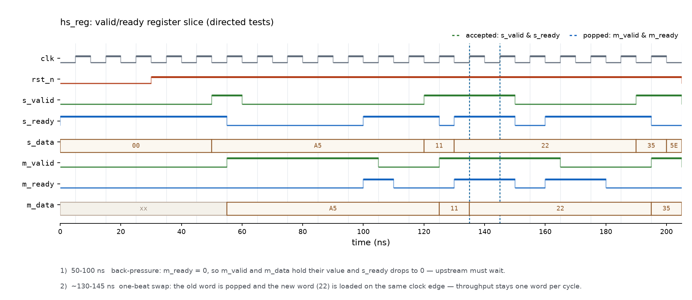
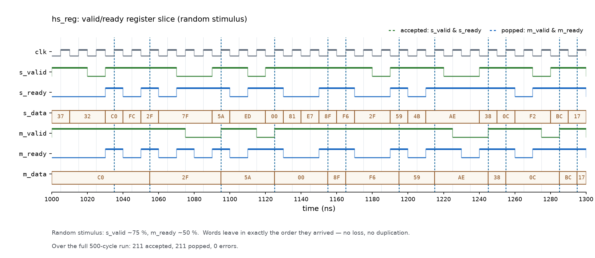
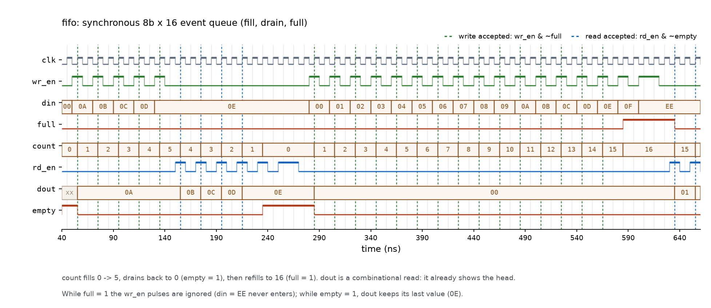
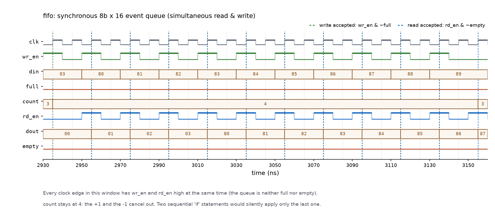
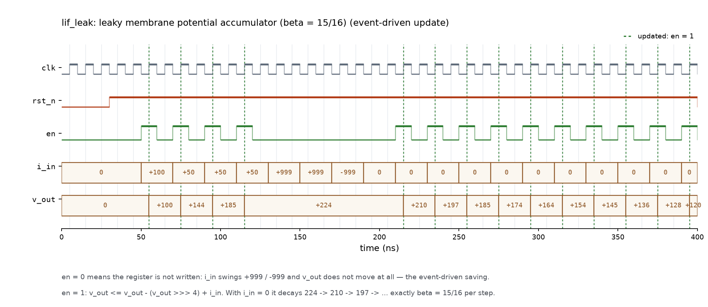

# snn-hw-lab · 事件驱动 SNN 加速器：前端 RTL 起步

> 三个可综合的小模块，是最终项目里真实要用的三块积木：**事件队列（FIFO）**、
> **LIF 神经元（泄漏累加）**、**AER 事件派发（valid/ready 握手）**。
> 目标不是"学语法"，而是能独立写出可综合的时序逻辑，并能在综合报告里把
> 手写的每一行代码对应到真实硬件单元（FDCE / FDRE / LUT / RAM32M）。

**English abstract.** Three synthesizable RTL building blocks for an event-driven
spiking neural network accelerator: a synchronous FIFO (event queue), a leaky
membrane-potential accumulator (LIF neuron core), and a valid/ready register
slice (AER event dispatch). Each block ships with a self-checking testbench
that prints `PASS` / `FAIL`; resource numbers were measured with Vivado 2019.1
synthesis on `xc7a35tcsg324-1`.

---

## 1. 结果一览

| # | 模块 | 功能 | 自检测试 | Slice LUTs | Registers | BRAM | DSP |
|---|---|---|---|---|---|---|---|
| 01 | [`fifo`](01_fifo/fifo.v) | 同步 FIFO，8 bit × 16 深，组合读出（首字直通） | **114 项 / 0 失败** | 28（其中 8 为 LUTRAM） | 16 | 0 | 0 |
| 02 | [`lif_leak`](02_lif_leak/lif_leak.v) | LIF 膜电位：泄漏 + 累加，16 bit 有符号，β = 15/16 | **92 项 / 0 失败** | 20 | 16 | 0 | 0 |
| 03 | [`hs_reg`](03_handshake/hs_reg.v) | valid/ready 握手寄存器，深度 1，支持背压与"一拍顶一拍" | **229 项 / 0 失败**（收 211 = 出 211） | 3 | 9 | 0 | 0 |

> 器件：`xc7a35tcsg324-1`（Artix-7 35T），可用资源 20800 LUT / 41600 FF / 50 BRAM / 90 DSP。
> 数字来自**综合**（`synth_design`），不是布局布线后的最终值；见第 5 节。

---

## 2. 目录结构

```
snn-hw-lab/
├── 01_fifo/            同步 FIFO —— 事件队列
│   ├── fifo.v          ← 设计（唯一需要你写的文件）
│   ├── tb_fifo.v       ← 自检测试平台（裁判，不要改）
│   ├── run_xsim.bat    ← Windows + Vivado XSim：跑仿真，打印 PASS/FAIL
│   ├── synth.bat/.tcl  ← 综合，生成 util.rpt（资源数字）
│   └── run.sh          ← Linux（iverilog + GTKWave）备用
├── 02_lif_leak/        带泄漏的膜电位累加器 —— LIF 神经元的心脏
├── 03_handshake/       valid/ready 握手寄存器 —— AER 事件派发
├── docs/
│   ├── NOTES.md        调试笔记：8 个踩过的坑 + 6 个自检问答
│   └── img/            波形图（由 tools/plot_waveform.py 从 dump.vcd 渲染）
├── tools/plot_waveform.py   VCD → 时序图（numpy + matplotlib + vcdvcd）
└── README.md
```

---

## 3. 怎么跑

只需要 Vivado（2019.1 或更新版本），**不需要建工程、不用点鼠标**。
每个练习目录里：

```bat
cd 01_fifo
run_xsim.bat            :: xvlog -> xelab -> xsim，秒级出 PASS / FAIL
run_xsim.bat gui        :: 打开波形窗口（在 Tcl 控制台敲 run -all）
synth.bat               :: 综合，30~60 秒后生成 util.rpt
```

脚本里的 `VIVADO_HOME` 是唯一需要按自己环境修改的一行。
在 Linux / WSL 下用 `bash run.sh`（需要 `iverilog` 和 `gtkwave`）。

> ⚠️ 两个实测坑（`docs/NOTES.md` 第 7、8 条）：
> ① `.bat` 里不能写中文（`chcp 65001` 下 cmd 会按错误字节位置切行）；
> ② `if ... ( ... )` 块内不能出现半角括号（`)` 会被当成块的结束符）。

---

## 4. 三个设计要点

### 4.1 FIFO：用 `case` 一次覆盖四种状态

`count` 最容易写错。下面这种"两个并列 `if`"在**同时读写**时会算错：

```verilog
if (do_wr) count <= count + 1;   // 非阻塞赋值：后一条会覆盖前一条
if (do_rd) count <= count - 1;   // 同时读写时 count 错误地减 1
```

正确写法是把两个使能拼成一个 2 位向量，用 `case` 一次列清：

```verilog
case ({do_wr, do_rd})
    2'b10:   cnt <= cnt + 1'b1;
    2'b01:   cnt <= cnt - 1'b1;
    default: cnt <= cnt;
endcase
```

综合结果印证了"小 FIFO 不用 BRAM"：16×8 的存储体被推断成 **RAM32M × 2**
（分布式 RAM，占 8 个 LUT 当存储用），16 个触发器全部来自 `cnt`(8) + 两个指针(4+4)。

### 4.2 LIF：`en = 0` 时整拍不翻转，这就是省电的物理来源

```verilog
v_out <= v_out - (v_out >>> SHIFT) + i_in;   // 只有 en = 1 才执行
```

- 泄漏写成 `v - (v >>> SHIFT)`，其中 β = 1 − 2^−SHIFT。**一次乘法被换成"移位 + 减法"**，
  综合后 DSP 占用为 0——这是低功耗 AI 芯片里最典型的思路。
- 必须用**算术右移 `>>>`**（保留符号位），`>>` 会让负数变成很大的正数。
- `en = 0` 时寄存器不写，综合出来 16 个触发器全是 **FDCE**，CE 端被拉低 → 一个都不翻转。
  事件驱动加速器的能效优势，在 RTL 层面就是这一行"不写"。

### 4.3 握手寄存器：为什么 `ready` 可以组合、`valid` 必须寄存

```verilog
assign s_ready = (~m_valid_r) | m_ready;   // 组合：空着，或下游正在取走
```

- `ready` 是**反向**的许可信号，必须当拍直通。若打成寄存器，每笔传输多耗一拍，**吞吐砍半**。
- `valid` 与数据同向前进，必须和 `m_data` 一起被寄存器切一拍；否则上游组合逻辑会穿过本模块
  直捅下游，形成贯穿多级的长路径（时序崩）。
- 数据寄存器**故意不复位**：`m_valid_r = 0` 已经表示"手里没货"，数据位复位没有意义。
  综合报告印证了这一点：**1 × FDCE（`m_valid_r`，异步复位）+ 8 × FDRE（`m_data_r`，复位脚接 0）**。
- 3 个 LUT 的完整拆解：`s_ready` 的或门（LUT2）、数据使能 `s_valid & s_ready` 的与门（LUT3）、
  把低有效 `rst_n` 反相成 FDCE 的 `CLR`（LUT1）。**全部组合逻辑 = 一个或门 + 一个与门**。

这个结构在工业界叫 **register slice**（AXI 里的"前向寄存、后向直通"）。
若 `ready` 链太长（跨多级模块），才会升级成深度 2 的 skid buffer，代价是面积和一拍延迟。

### 4.4 波形：握手在时间轴上长什么样

> 本节所有波形图**都不是截图**：`tools/plot_waveform.py` 读取 XSim 导出的 `dump.vcd`，
> 用 matplotlib 渲染。每次跑完 `run_xsim.bat` 都能重新生成，图和代码永远同步、不会过期。

**定向测试段（0–205 ns）**



- **50–100 ns**：下游 `m_ready = 0`。`m_valid` 保持 1、`m_data` 保持 `A5`，`s_ready` 掉到 0
  —— 数据一位都没动，上游被回头看住（背压）。
- **≈135 ns**：绿色虚线与蓝色虚线重合的那一拍——**同一个上升沿**里，旧数 `11` 被下游取走、
  新数 `22` 同时装进来。这就是"一拍顶一拍"，吞吐不掉。
- 复位后 `m_data` 显示 `xx` 是正常的：**数据寄存器故意不复位**（见 4.3）。

**随机激励段（1000–1300 ns）**



- 上游约 75% 概率给数据、下游约 50% 概率能收，两边节奏完全不对齐。
- 对比 `s_data` 与 `m_data` 两行的取值序列：`C0 2F 5A 00 8F F6 59 AE 38 0C BC 17`
  —— **一进一出、顺序完全一致**，不丢不重不乱序。
- 整个 500 拍跑完：**211 收 = 211 出，0 失败**。

复现（先跑一次仿真生成 `dump.vcd`，再用 venv 里的 Python）：

```bash
python tools/plot_waveform.py 03_handshake/dump.vcd docs/img/hs-reg-directed.png hs 0 205
```

### 4.5 波形：FIFO 的满、空、以及"同时读写"

**填 → 排空 → 再填满（40–660 ns）**



- `count` 从 0 累到 5，再被读空回 0（`empty` 拉高），然后重新填到 16（`full` 拉高）。
- `dout` 是**组合读出**：只要 `count > 0`，队首数据就已经挂在端口上，不需要先给 `rd_en`
  （所以 `dout` 在 55 ns 就变成 `0A`，而第一次读发生在 145 ns）。
- `full = 1` 期间 `wr_en` 照样在打脉冲，但**被忽略**：`din = EE` 永远进不去，
  `count` 卡在 16，直到 645 ns 有一次读腾出位置。
- `empty = 1` 之后 `dout` 保持最后一个读出的值（`0E`）——规格要求如此，不是残留。

**同时读写（2930–3160 ns）**



- 每一拍 `wr_en` 与 `rd_en` 同时为 1，而且既不满也不空：`count` **停在 4 纹丝不动**。
- 这就是踩坑日志第 2 条：写成两个并列 `if` 时，后一条非阻塞赋值会**覆盖**前一条，
  `count` 会错误地 −1。正确写法是 `case ({do_wr, do_rd})` 一次列清四种情况。

### 4.6 波形：LIF 的"事件驱动"长什么样



- **120–215 ns**：`i_in` 在 `+999` / `−999` 之间来回跳，但 `en = 0` → `v_out` **一动不动**。
  这不是仿真没刷新，而是那 16 个触发器整拍没有使能、一个都不翻转——事件驱动省电的物理来源。
- **`en = 1` 的拍**：执行 `v_out <= v_out - (v_out >>> 4) + i_in`。
  从 224 开始、`i_in = 0` 时依次 224 → 210 → 197 → 185 → …，每步正好 ×15/16，
  这就是 `beta = 1 - 2^-SHIFT` 在波形上的样子。
- 负数的算术右移由测试平台的"阶段 7"专门覆盖（重复 10 次），这里不重复展示。

五张图的完整重现命令（每个模块先跑一次 `run_xsim.bat` 生成 `dump.vcd`）：

```bash
python tools/plot_waveform.py 03_handshake/dump.vcd docs/img/hs-reg-directed.png   hs   0    205
python tools/plot_waveform.py 03_handshake/dump.vcd docs/img/hs-reg-random.png     hs   1000 1300
python tools/plot_waveform.py 01_fifo/dump.vcd      docs/img/fifo-overview.png    fifo 40   660
python tools/plot_waveform.py 01_fifo/dump.vcd      docs/img/fifo-simultaneous.png fifo 2930 3160
python tools/plot_waveform.py 02_lif_leak/dump.vcd  docs/img/lif-update.png       lif  0    400
```

---

## 5. 这些数字能说明什么、不能说明什么

| 能说 | 不能说 |
|---|---|
| 综合后 LUT / FF / BRAM / DSP 占用 | ~~最高频率 fmax~~（需要 implementation，本项目只做到 synthesis） |
| 每个功能单元的硬件代价（如"泄漏+累加 = 约 20 LUT"） | ~~实测功耗~~（没有板子、没有电流表） |
| 设计意图与综合结果的对应关系（FDCE / FDRE / RAM32M） | ~~与其他加速器的公平性能对比~~（尚无端到端负载） |

写进展报告 / 简历时请按这个边界表述，避免"编数字"。

---

## 6. 路线图

- [x] **阶段一**：三个基础 RTL 模块（FIFO / LIF / 握手）+ 综合资源数字 ← *当前进度*
- [ ] **阶段二**：Python 定点黄金模型（numpy），与 RTL 对拍
- [ ] **阶段三**：LIF 阵列 + 事件队列组网，AER 派发
- [ ] **阶段四**：N-MNIST 事件流端到端仿真，统计有效计算次数与能效

---

## 7. 环境

| 项目 | 版本 / 说明 |
|---|---|
| 仿真 | Vivado XSim 2019.1（`xvlog` / `xelab` / `xsim`），自检测试平台打印 PASS / FAIL |
| 综合 | Vivado 2019.1 batch 模式，`xc7a35tcsg324-1`，输出 `util.rpt` |
| 备用链路 | `run.sh`：iverilog + GTKWave（Linux / WSL） |
| 波形工具 | Python 3.12 + numpy / matplotlib / vcdvcd（`tools/plot_waveform.py`） |
| 语言 | Verilog-2005，纯可综合子集（无 `initial`、无延时、无 `$display` 在 RTL 里） |
